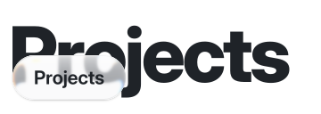
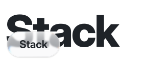
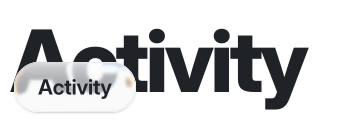
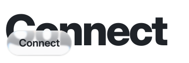
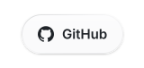
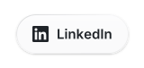
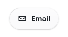

# Hey, I'm Sachit 👋

### `> building things that work.`

**AI & Web Developer · Full-Stack Architect · Prompt Engineer**

 

I build full-stack web applications, architect AI integrations, and automate workflows.
Student developer learning by turning ideas into working projects.

---
<picture><source media="(prefers-color-scheme: dark)" srcset="assets/divider-dark.svg"></picture>
<h3><picture><source media="(prefers-color-scheme: dark)" srcset="assets/heading-projects-dark.svg"></picture></h3>
 

| Project | What it does | Built with |
| --- | --- | --- |
| [AUDIFY](https://github.com/sachit1751-art/Audify) | Cross-platform music app, with Android and desktop clients; focused on playback, libraries, playlists and listening across devices | Kotlin, Jetpack Compose, TypeScript and project-specific tooling |

<picture><source media="(prefers-color-scheme: dark)" srcset="assets/divider-dark.svg"></picture>

<h3><picture><source media="(prefers-color-scheme: dark)" srcset="assets/heading-stack-dark.svg"></picture></h3>
 

| Area | Tools and technologies |
| --- | --- |
| Languages | Kotlin, Java, TypeScript, JavaScript, Python, Rust, Go |
| Android | Jetpack Compose, Android app development |
| Web | React, Next.js, Vite, Tailwind CSS, Three.js |
| Backend and data | Node.js, PostgreSQL, Supabase |
| Workflow | Git, GitHub, Linux, automation and AI-assisted development |

<picture><source media="(prefers-color-scheme: dark)" srcset="assets/divider-dark.svg"></picture>

<h3><picture><source media="(prefers-color-scheme: dark)" srcset="assets/heading-activity-dark.svg"></picture></h3>
 

 

See my [pull requests](https://github.com/pulls?q=is%3Apr+author%3Asachit1751-art+-user%3Asachit1751-art), [merged contributions](https://github.com/pulls?q=is%3Apr+author%3Asachit1751-art+is%3Amerged+) and [review activity](https://github.com/pulls?q=is%3Apr+reviewed-by%3Asachit1751-art+-user%3Asachit1751-art).

<picture><source media="(prefers-color-scheme: dark)" srcset="assets/divider-dark.svg"></picture>

<h3><picture><source media="(prefers-color-scheme: dark)" srcset="assets/heading-connect-dark.svg"></picture></h3>
 

<a href="https://github.com/sachit1751-art"><picture><source media="(prefers-color-scheme: dark)" srcset="assets/btn-github-dark.svg"></picture></a><a href="https://www.linkedin.com/in/sachit1751"><picture><source media="(prefers-color-scheme: dark)" srcset="assets/btn-linkedin-dark.svg"></picture></a><a href="mailto:sachit1751@gmail.com"><picture><source media="(prefers-color-scheme: dark)" srcset="assets/btn-email-dark.svg"></picture></a>

